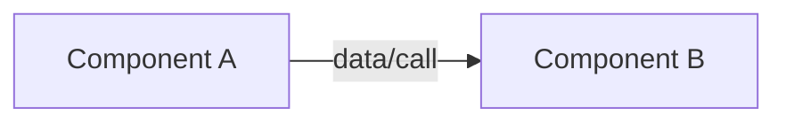
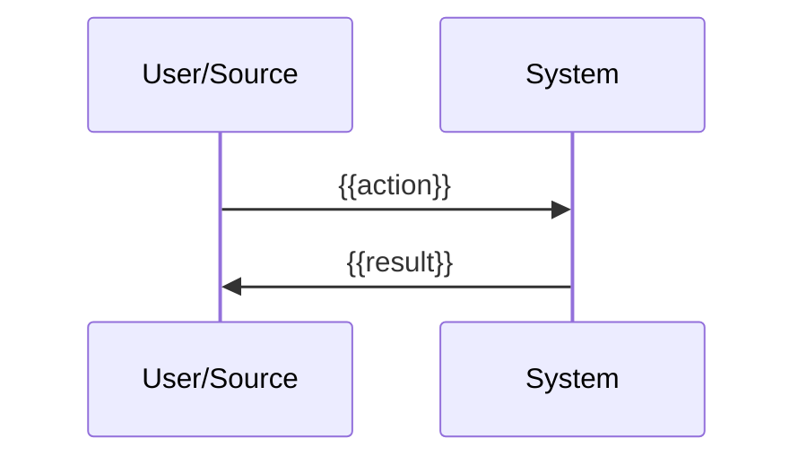

# Architecture: {{Title}}

## Overview

{{1–3 sentences}}

## Technology Stack

| Decision                  | Choice  | Why     | Alternatives Considered |
| ------------------------- | ------- | ------- | ----------------------- |
| {{e.g. Language/runtime}} | {{...}} | {{...}} | {{...}}                 |

## Components

### {{Component Name}}

- **Responsibility**: {{single responsibility}}
- **Exposes**: {{interface}}
- **Depends on**: {{other components/services}}

## Architecture Diagram

## Data Flow

## External Integrations

| Integration | MCP-backed path     | Fallback path                 |
| ----------- | ------------------- | ----------------------------- |
| {{Jira}}    | {{MCP server/tool}} | {{direct input / local file}} |

## Error-Handling Strategy

| Boundary | Failure mode | Behavior |
| -------- | ------------ | -------- |
| {{...}}  | {{...}}      | {{...}}  |

## Security Boundaries

- {{trust zones, validation points, secret handling}}

## Configuration

- {{env vars, required vs optional, defaults}}

## Unresolved Decisions

- {{anything genuinely requiring human input before implementation — empty list if none}}
