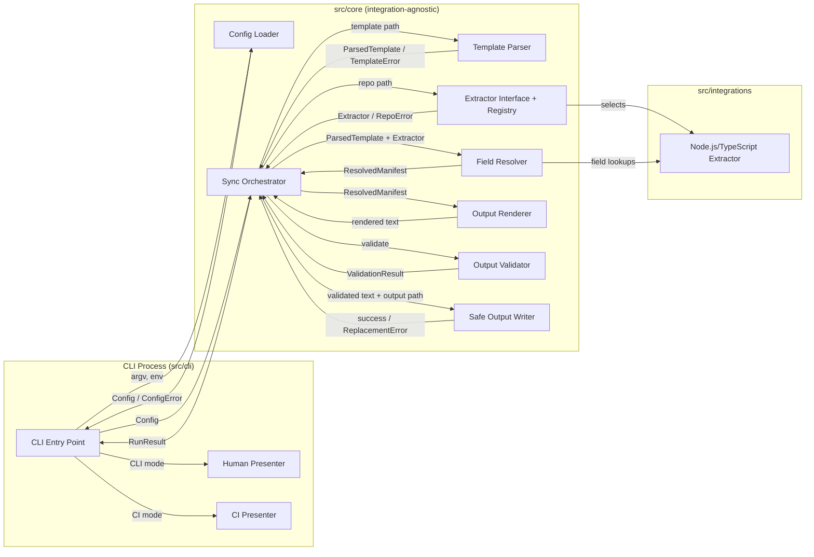

# Architecture: Automated Technical Documentation Sync (v1)

## Overview

A Node.js/TypeScript CLI tool that reads a master Markdown template and a local source
repository, resolves every template field to a found value, `"Not Found"`, or
`"Not Specified"` through a pluggable extractor, renders a structurally-identical manifest,
and replaces the output file only after full validation succeeds — safely, on Windows and
POSIX, in both a human-readable CLI mode and a CI-hookable JSON mode.

## Technology Stack

| Decision              | Choice                                                                                                                                                                                                                                                      | Why                                                                                                                                                                                                                                                                          | Alternatives Considered                                                                                                                                                                                                                                         |
| --------------------- | ----------------------------------------------------------------------------------------------------------------------------------------------------------------------------------------------------------------------------------------------------------- | ---------------------------------------------------------------------------------------------------------------------------------------------------------------------------------------------------------------------------------------------------------------------------- | --------------------------------------------------------------------------------------------------------------------------------------------------------------------------------------------------------------------------------------------------------------- |
| Language/runtime      | Node.js ≥ 20 + TypeScript                                                                                                                                                                                                                                   | Matches the confirmed v1 scope decision (Node/TS is the only extractor shipped); already scaffolded in this repo; Node's `fs` module gives the cross-platform primitives FR-10 needs                                                                                         | Python (capable, but duplicates a toolchain already set up and doesn't match the confirmed extractor target); Go (good single-binary CLI story, but introduces a second language into the repo with no justified need)                                          |
| CLI help/version text | `commander` (already a dependency), used **only** to format `--help`/`--version` output — the NFR-3 allow-list/rejection logic is deliberately hand-written in Config Loader instead, so the security-critical path stays fully auditable (see Code Review) | Keeps `commander` for the one thing it's genuinely convenient for, without letting its own option-parsing become the thing enforcing a security boundary                                                                                                                     | Hand-rolling help text too (no real benefit over `commander`'s formatter for this narrow use)                                                                                                                                                                   |
| Template parsing      | Custom line-oriented parser (headings = sections, `- **Field**: value` bullets = fields)                                                                                                                                                                    | Required to guarantee byte-exact structural preservation (FR-5) and determinism (NFR-2) — rewriting only field values in place, never re-serializing the whole document                                                                                                      | A general Markdown AST library (`remark`/`markdown-it`): robust for arbitrary Markdown, but re-serialization is not guaranteed to reproduce the original byte-for-byte, which risks FR-5/NFR-2; also a heavier dependency for a narrowly-shaped template format |
| `.env`/config loading | Small internal parser (no new dependency)                                                                                                                                                                                                                   | Keeps full control over exactly what is read and what is ever logged — directly supports NFR-3's guarantee; `.env` syntax used here is trivial (`KEY=VALUE` lines)                                                                                                           | `dotenv` package: common, but outsources the one piece of logic (what gets read/exposed) we most need to control and audit ourselves                                                                                                                            |
| Validation            | Hand-written checks in Output Validator / Config Loader, no library                                                                                                                                                                                         | The validation needed (field-state completeness, evidence presence, flag allow-list) was simple enough that a schema library added a dependency without reducing code — `zod` was removed during Code Review once grepping confirmed it was never actually imported anywhere | `zod` (originally planned in scaffolding; dropped — see Code Review for why)                                                                                                                                                                                    |
| Testing               | `vitest` (already configured)                                                                                                                                                                                                                               | Already set up in scaffolding                                                                                                                                                                                                                                                | `jest` (comparable; no reason to switch)                                                                                                                                                                                                                        |

## Components

### CLI Entry Point (`src/cli/index.ts`)

- **Responsibility**: parse `argv`, hand off to Config Loader, invoke the Sync Orchestrator,
  select the Human or CI Presenter based on mode, map the final `RunResult.status` to the
  process exit code (the _only_ place this mapping happens, so CLI and CI modes can't drift),
  and wrap everything in a top-level `try/catch` so no unexpected error ever reaches the user
  as a raw stack trace (NFR-1).
- **Depends on**: Config Loader, Sync Orchestrator, Presenters.

### Config Loader (`src/core/config.ts`)

- **Responsibility**: resolve `templatePath`, `repoPath`, `outputPath`, and CI-mode flag from
  `argv` and the three named environment variables (`DOC_SYNC_TEMPLATE_PATH`,
  `DOC_SYNC_SOURCE_REPO_PATH`, `DOC_SYNC_OUTPUT_PATH`) — FR-1/FR-9. When both a CLI flag and
  the corresponding env var are given for the same setting, **the CLI flag wins** (explicit
  over implicit). Enforces NFR-3 **before any file I/O, and before `commander`'s own argument
  parsing runs**: raw `argv` is pre-scanned against a fixed allow-list — `--template`,
  `--repo`, `--output`, `--ci`, plus `commander`'s standard meta-flags `--help`/`-h` and
  `--version`/`-V` (explicitly included so basic CLI usability isn't broken by the NFR-3
  check) — and anything else, including anything matching a secret-indicating name pattern
  (`token`, `secret`, `key`, `password`, `credential`, case-insensitive), is rejected before
  `commander` ever sees it, so `commander`'s own default unknown-option handling never fires
  and never produces an uncontrolled error message. The rejection message names only the
  flag, never a value. Reads **only** its three named env
  vars by exact key — it never enumerates or logs `process.env` as a whole, which is what
  actually keeps unrelated secrets (e.g. this pipeline's own `JIRA_API_TOKEN`, present in the
  same shared `.env` for other stages) from ever being able to leak through this tool, even
  though this tool doesn't use them.
- **Exposes**: `resolveConfig(argv, env): Config | ConfigError`.
- **Depends on**: nothing (pure except for reading `.env` text, if present).

### Template Parser (`src/core/template/parser.ts`)

- **Responsibility**: read the master template file and parse it into an ordered
  `ParsedTemplate` (sections → ordered fields), preserving heading hierarchy and field order
  (FR-2). Reports a missing/unreadable path or a malformed structure as a specific,
  location-identifying error (FR-8(a): `TEMPLATE_NOT_FOUND` / `TEMPLATE_MALFORMED`).
- **Exposes**: `parseTemplate(path): ParsedTemplate` (throws `TemplateError`).
- **Depends on**: filesystem (read-only).

### Extractor Interface & Registry (`src/core/extraction/extractor.ts`)

- **Responsibility**: define the `Extractor` contract — for a given field, return
  `{status: 'found', value, evidence}`, `{status: 'not-found'}`, or `{status:
'not-specified'}` — and expose each extractor's **fixed, statically-declared** set of
  "Not Specified" fields (the Field Resolution Rule safeguard from `requirements.md`: this set
  is a static property of the extractor, never computed dynamically per run, so it structurally
  cannot be used to skip an evidence check). The Registry selects the active extractor for a
  given repo path (v1: always the Node.js/TypeScript extractor). This interface, not any
  concrete extractor, is what the rest of core code depends on — satisfying NFR-4/AC-9: adding
  a second extractor means adding a new implementation here, with zero changes to Template
  Parser, Field Resolver, Output Renderer, or Output Validator.
- **Exposes**: `Extractor` interface, `getExtractor(repoPath): Extractor | RepoError`.
- **Depends on**: nothing else in `src/core`.

### Node.js/TypeScript Extractor (`src/integrations/extractors/nodejs/`)

- **Responsibility**: the v1 concrete `Extractor`. Reads `package.json`, `tsconfig.json`,
  `README.md`, `Dockerfile`, and `.github/workflows/*.yml` where present (FR-3's
  assumption-flagged evidence list) and defines a lookup rule per template field. Declares its
  fixed "Not Specified" set — in v1, just `"Owning Team"` (no code artifact in this list can
  structurally answer an organizational/people question — see `requirements.md`'s worked
  example). A missing _individual_ evidence file is not an error here; it simply means that
  field's lookup rule finds nothing and resolves `"Not Found"` — this is how FR-8(b)'s
  empty/partial-repository behavior falls directly out of normal extractor logic rather than
  being a separate code path that could drift out of sync with the happy path. **Deterministic
  tie-breaking**: where a lookup rule has multiple candidate evidence files (e.g. more than one
  file under `.github/workflows/*.yml`), candidates are sorted lexicographically by filename
  before the rule picks one, so the result never depends on OS directory-iteration order
  (NFR-2).
- **Exposes**: implements `Extractor`.
- **Depends on**: filesystem (read-only).

### Field Resolver (`src/core/resolution/fieldResolver.ts`)

- **Responsibility**: for every field in the `ParsedTemplate`, call the active extractor and
  classify the result into exactly one of `Found | "Not Found" | "Not Specified"` (FR-4),
  reading the extractor's static "Not Specified" set (not asking the extractor to decide
  per-call) so the Field Resolution Rule safeguard is enforced structurally in core code,
  independent of which extractor is active. **Contains errors per field**: each field's
  extractor lookup runs inside its own catch boundary — an unexpected error reading one
  specific evidence file (e.g. a permission error on a single file in an otherwise-accessible
  repository) resolves that one field to `"Not Found"` (with an internal diagnostic note),
  never the whole run. True tool-level failures are reserved for the three FR-8(a) cases,
  which are checked once, up front, before field-by-field resolution begins — not raised as a
  side effect of an individual field lookup.
- **Exposes**: `resolveFields(template, extractor): ResolvedManifest`.
- **Depends on**: the `Extractor` interface only, never a concrete extractor module.

### Output Renderer (`src/core/render/renderer.ts`)

- **Responsibility**: render a `ResolvedManifest` into Markdown that is structurally identical
  to the original template (FR-5) — same headings, same field order, same surrounding prose —
  substituting only field values. A pure function of its input: no timestamps, no
  machine-dependent paths, no non-deterministic ordering, so identical inputs always produce
  identical output text (NFR-2).
- **Exposes**: `renderManifest(resolvedManifest): string`.
- **Depends on**: nothing.

### Output Validator (`src/core/validation/outputValidator.ts`)

- **Responsibility**: before any file is touched, validate the rendered output against the
  `ParsedTemplate` and `ResolvedManifest`: every original section/field present and in order,
  every field resolved to exactly one of {value, "Not Found", "Not Specified"} with none
  blank/null (AC-11), and every "found" value traceable to the evidence reference the extractor
  attached (AC-6) — checked against the structured `ResolvedManifest`, not by re-parsing the
  rendered text. **Limitation**: this validator confirms an evidence pointer is _present_ for
  every found value; it does not independently re-verify that the pointer is _accurate_. Full
  AC-6 compliance (no invented values) ultimately depends on each extractor's lookup-rule
  correctness, verified via Stage 6 Code Review and targeted tests — not a generic runtime
  guarantee this validator alone can provide.
- **Exposes**: `validateOutput(resolvedManifest, renderedText): ValidationResult`.
- **Depends on**: nothing.

### Safe Output Writer (`src/core/io/safeWriter.ts`)

- **Responsibility**: implement FR-10. Writes validated output to a temp file in the same
  directory as the destination (so a same-volume rename is possible on both POSIX and
  Windows), attempts the safest replacement operation available, retries **up to 3 times with
  a short backoff** on a transient lock (e.g. Windows `EBUSY`), and on persistent failure
  reports a tool-level failure _without_ touching the existing destination file. Guarantees the
  temp file is deleted in every outcome — success, validation failure (never even attempted),
  or replacement failure.
- **Exposes**: `safeReplace(content, destinationPath): Promise<void>` (throws
  `ReplacementError`, always having cleaned up).
- **Depends on**: Node's `fs` module only.

### Sync Orchestrator (`src/core/orchestrator.ts`)

- **Responsibility**: the single place that sequences Config → Template Parser → Extractor
  Registry → Field Resolver → Output Renderer → Output Validator → Safe Output Writer for one
  run, and produces one uniform `RunResult` (status, found/unresolved counts, output path, or
  errorCode/errorMessage) that **both** presenters render from — the single source of truth
  that keeps the human-readable summary and the FR-11 JSON summary from ever disagreeing with
  each other (DRY; avoids duplicating success/failure logic per presentation mode).
- **Exposes**: `runSync(config): Promise<RunResult>`.
- **Depends on**: every core module above, plus the active `Extractor`.

### Presenters (`src/cli/presenters/{humanPresenter,ciPresenter}.ts`)

- **Responsibility**: turn a `RunResult` into either a console summary (CLI mode, alongside
  the already-written Markdown manifest) or the FR-11 JSON summary written to stdout (CI
  mode). Exit-code mapping itself lives in the CLI Entry Point, not here, so it's defined once.
- **Exposes**: `presentHuman(result)`, `presentCI(result)`.
- **Depends on**: the `RunResult` type only.

## Architecture Diagram



## Data Flow

```mermaid
sequenceDiagram
  participant User
  participant CLI as CLI Entry Point
  participant Cfg as Config Loader
  participant Orch as Sync Orchestrator
  participant Parser as Template Parser
  participant Reg as Extractor Registry
  participant Ext as Node/TS Extractor
  participant Resolver as Field Resolver
  participant Renderer as Output Renderer
  participant Validator as Output Validator
  participant Writer as Safe Output Writer

  User->>CLI: doc-sync --template --repo --output [--ci]
  CLI->>Cfg: resolveConfig(argv, env)
  Cfg-->>CLI: Config (or ConfigError: reject secret/unknown flag, no value echoed)
  CLI->>Orch: runSync(Config)
  Orch->>Parser: parseTemplate(templatePath)
  Parser-->>Orch: ParsedTemplate (or TemplateError -> FR-8(a) failure, stop here)
  Orch->>Reg: getExtractor(repoPath)
  Reg-->>Orch: Extractor (or RepoError -> FR-8(a) failure, stop here)
  Orch->>Resolver: resolveFields(ParsedTemplate, Extractor)
  Resolver->>Ext: lookup(field) for each field
  Ext-->>Resolver: found | not-found | not-specified
  Note over Resolver,Ext: Empty/partial repo (FR-8(b)) is not a branch here -<br/>it's just many "not-found" results, same code path
  Resolver-->>Orch: ResolvedManifest
  Orch->>Renderer: renderManifest(ResolvedManifest)
  Renderer-->>Orch: rendered text
  Orch->>Validator: validateOutput(ResolvedManifest, text)
  Validator-->>Orch: ValidationResult (failure -> stop, nothing written)
  Orch->>Writer: safeReplace(text, outputPath)
  Writer-->>Orch: success, or ReplacementError (existing file untouched, temp cleaned)
  Orch-->>CLI: RunResult
  CLI-->>User: Markdown manifest + console summary, OR JSON summary; exit code set
```

## External Integrations

**None in v1.** This application reads only local files (master template, source repository)
and writes only a local output file — no Jira, Confluence, or Git-hosting access at runtime,
per the confirmed v1 scope decision in `requirements.md`. Note the distinction already
recorded there: Jira/Confluence/Word as a _user-story source_ applies to the broader pipeline's
Stage 1 (gathering the requirement itself), not to this application's own template/repo inputs.
Future remote-repository access is a documented possibility (see `mcp/README.md` at the
pipeline level) but is not wired into this tool.

## Error-Handling Strategy

| Boundary                  | Failure mode                                           | Behavior                                                                                                                                      |
| ------------------------- | ------------------------------------------------------ | --------------------------------------------------------------------------------------------------------------------------------------------- |
| CLI argument parsing      | Secret-shaped or unrecognized flag                     | Fail closed before any I/O; error names the flag, never its value (NFR-3)                                                                     |
| Template file read        | Missing/unreadable path                                | FR-8(a) failure: `TEMPLATE_NOT_FOUND`, non-zero exit, existing output untouched                                                               |
| Template parse            | Malformed structure                                    | FR-8(a) failure: `TEMPLATE_MALFORMED` with location, non-zero exit                                                                            |
| Repository path access    | Missing/inaccessible path                              | FR-8(a) failure: `REPO_NOT_FOUND`, non-zero exit                                                                                              |
| Repository evidence files | Individual file missing (empty/partial repo)           | Not an error — field resolves `"Not Found"` (FR-8(b)); run succeeds, exit 0                                                                   |
| Output validation         | Rendered output fails structural/completeness check    | Treated as a generation failure; nothing written to the output path                                                                           |
| Output replacement        | Destination locked / cross-volume / transient OS error | Up to 3 retries with a short backoff, then a tool-level failure if still blocked; existing file preserved, temp file cleaned up (FR-10/AC-13) |
| Any unhandled exception   | Unanticipated error anywhere in the pipeline           | Top-level `try/catch` in the CLI Entry Point converts it to a generic tool-level failure exit — never an unhandled crash (NFR-1)              |

## Security Boundaries

- **Input validation boundary**: the Config Loader is the only place `argv`/env vars are read;
  narrow and auditable by design.
- **Untrusted content**: source repository and template content are read-only data — never
  executed, never interpolated into a shell command, never evaluated.
- **No network access in v1**: eliminates an entire class of exfiltration/SSRF concerns for
  this tool, since there is nothing to call out to.
- **Secret containment**: the Config Loader reads only its three named env vars by exact key
  and never enumerates or logs `process.env` as a whole — this is what prevents an unrelated
  secret already present in a shared `.env` (e.g. this _pipeline's_ own `JIRA_API_TOKEN`, used
  by other stages) from ever being able to leak through this tool's output or logs, even though
  this tool has no use for it.
- **Write confinement**: the only files this tool ever writes are the configured output path
  and its co-located temporary file during replacement — nothing else, ever.
- **Accepted risk — secrets committed in the documented repository**: the Node.js/TypeScript
  Extractor reads `Dockerfile` and CI workflow YAML from the repository _being documented_. If
  that repository has a credential hardcoded in one of those files (e.g. `ENV API_KEY=...`, or
  a literal token in a workflow step), the extractor will treat it as evidence and the Output
  Renderer will copy it into the generated manifest. `requirements.md`'s Out-of-Scope section
  deliberately excludes building a general secret-scanning engine for arbitrary content — this
  note exists so that scope decision is visible here too, not only in `requirements.md`. Users
  running this tool against a repository with poor secret hygiene should expect that exposure
  to be reflected in the generated manifest.

## Configuration

| Setting          | Env var                     | CLI flag     | Notes                                                                 |
| ---------------- | --------------------------- | ------------ | --------------------------------------------------------------------- |
| Template path    | `DOC_SYNC_TEMPLATE_PATH`    | `--template` | CLI flag overrides env var if both given                              |
| Source repo path | `DOC_SYNC_SOURCE_REPO_PATH` | `--repo`     | Same precedence rule                                                  |
| Output path      | `DOC_SYNC_OUTPUT_PATH`      | `--output`   | Same precedence rule                                                  |
| CI mode          | —                           | `--ci`       | Explicit flag selects the FR-11 JSON-summary mode (not TTY-detection) |

No secret configuration is required by this tool in v1 (it has no integrations); NFR-3's
rejection logic exists defensively, as explained under Security Boundaries.

## Unresolved Decisions

None remaining — the four decisions originally raised here were confirmed by the human on
2026-10-14 using the proposed defaults; see "Decisions Confirmed During Architecture Review"
below and the Revision History for what changed.

## Decisions Confirmed During Architecture Review (2026-10-14)

These were open questions in the initial draft of this document, confirmed by the human
rather than silently assumed:

- **CLI-arg vs. env-var precedence**: the CLI flag wins when both are given for the same
  setting (explicit over implicit) — `requirements.md` allowed either source but didn't pin
  down precedence; this document now does.
- **Secret-indicating flag-name pattern and the non-secret flag allow-list**: the pattern list
  is `token`, `secret`, `key`, `password`, `credential` (case-insensitive); the allow-list is
  exactly `--template`, `--repo`, `--output`, `--ci`.
- **CI-mode selection mechanism**: an explicit `--ci` flag, not auto-detected via non-TTY
  stdout.
- **Output-replacement retry policy**: up to 3 attempts with a short backoff on a transient
  lock (e.g. Windows `EBUSY`) before reporting a tool-level failure.

## Revision History

- **v1 (2026-10-14)**: Initial draft from the approved `requirements.md`, with four decisions
  flagged as unresolved (CLI/env precedence, secret-pattern/allow-list, CI-mode selection,
  replacement retry policy).
- **v2 (2026-10-14)**: All four decisions confirmed by the human using the proposed defaults;
  Config Loader, Safe Output Writer, Error-Handling Strategy, and Configuration sections
  updated to state them as settled rather than proposed. Design review findings 1-5 fixed
  (see design-review.md).
- **v3 (2026-10-14)**: Corrected during Stage 6 Code Review to match the as-built
  implementation: `commander`'s role narrowed to help/version text only (the NFR-3 allow-list
  logic is hand-written in Config Loader, not delegated to `commander`'s own parsing); `zod`
  removed from the Technology Stack row after `npm audit` plus a grep confirmed it (and
  `gray-matter`) were unused production dependencies carrying known vulnerabilities for no
  benefit - removed from `package.json` entirely.
